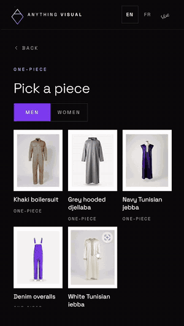
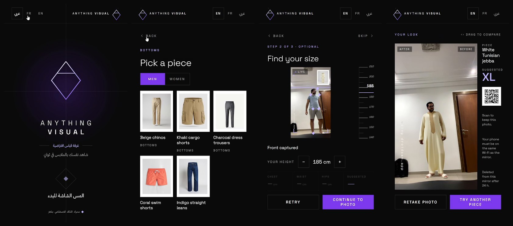
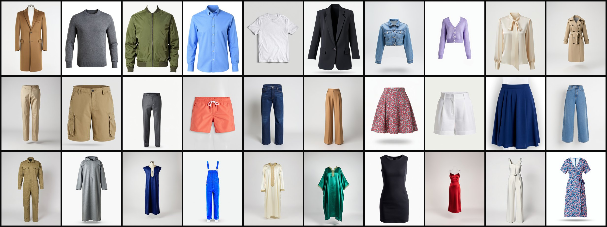

# Fashion Mirror

An AI fitting-room mirror for clothing shops. A shopper picks a piece on the screen, stands in front of the camera, and sees themselves wearing it in under 20 seconds. Then they scan a QR code to keep the photo on their phone.

*Recorded live on the kiosk: a phone used as the camera, an RTX GPU doing the render.* Full video on the [project page](https://alaabelghith.github.io/#portfolio/co/fm).

> This repository is a showcase. The Fashion Mirror software is not open source. The sizing step is: [**Size Scan**](https://github.com/alaabelghith/size-scan), with a [live demo](https://alaabelghith.github.io/lab/size-scan/) you can try with your own camera.

## What it does

- **Virtual try-on.** Tops, bottoms and one-pieces, from the shop's own product photos. The render itself takes about 8 seconds on an RTX 5070 Ti.
- **Size suggestion.** An optional two-pose scan (front, then side) estimates chest, waist and hips and suggests a size. Open source as [Size Scan](https://github.com/alaabelghith/size-scan).
- **Keep the photo.** A QR code opens the result on the shopper's phone, with a Save button. The photo is shared over the shop's Wi-Fi, not the internet.
- **Arabic, French, English**, right-to-left included. Dark and light themes.
- **Built for a shop floor.** Full-screen kiosk, hands-free capture with a countdown, can start with Windows, restarts itself if the engine stops, and returns to the welcome screen when nobody is using it.

## Privacy

- Everything runs on the kiosk PC. No cloud service, no account, no upload.
- Shopper photos are deleted automatically after 24 hours. Share links expire after 30 minutes.
- Only the kiosk screen can use the camera and the controls. A phone on the Wi-Fi can open its own photo link and nothing else.
- Usage statistics are counts only (sessions, pieces tried, render times). No photos, no personal data.

## Demo collection

Thirty pieces for demos: tops, bottoms and one-pieces, five for men and five for women in each, including a Tunisian jebba, a kaftan and a djellaba. Every product shot was generated on the kiosk PC with an open image model; none is a real brand's photo. A shop replaces them with its own catalogue.

## Requirements

| | |
|---|---|
| PC | Windows 10 or 11, 64-bit |
| GPU | NVIDIA, 8 GB memory or more, driver 570+ |
| Camera | A webcam, or a phone used as the camera |
| Screen | Portrait screen or a TV turned vertical; touch is optional |
| Network | Shop Wi-Fi or the PC's hotspot, only for the QR photo sharing |

It installs per user, without administrator rights.

## Status

Working prototype, tested end to end on the kiosk PC. Looking for **pilot shops in Tunisia**.

## Contact

Alaa Belghith · Anything Visual · Tunis
[alaabelghith.github.io](https://alaabelghith.github.io) · belguithalaa@gmail.com

© 2026 Alaa Belghith. All rights reserved; see [LICENSE](LICENSE).
